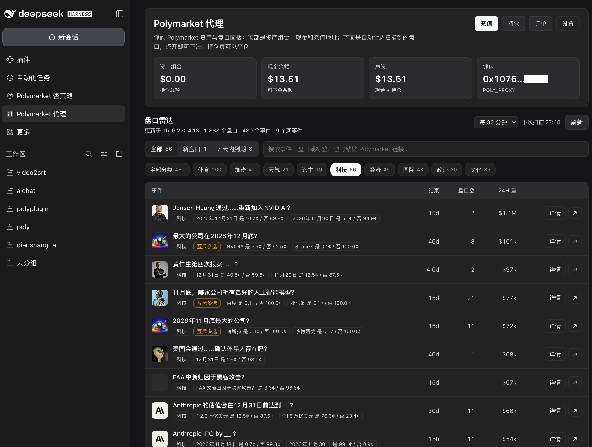
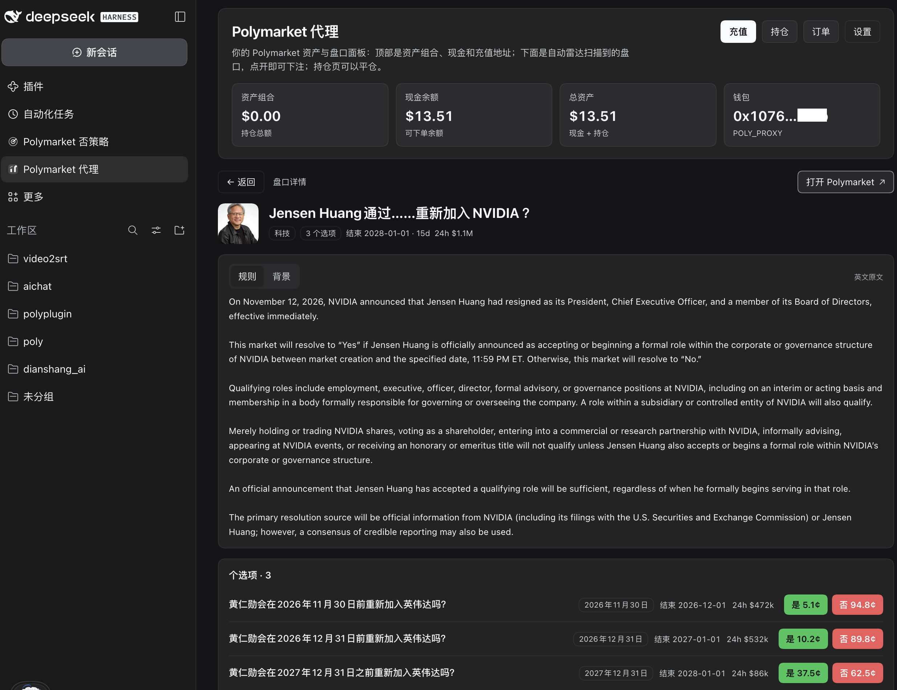
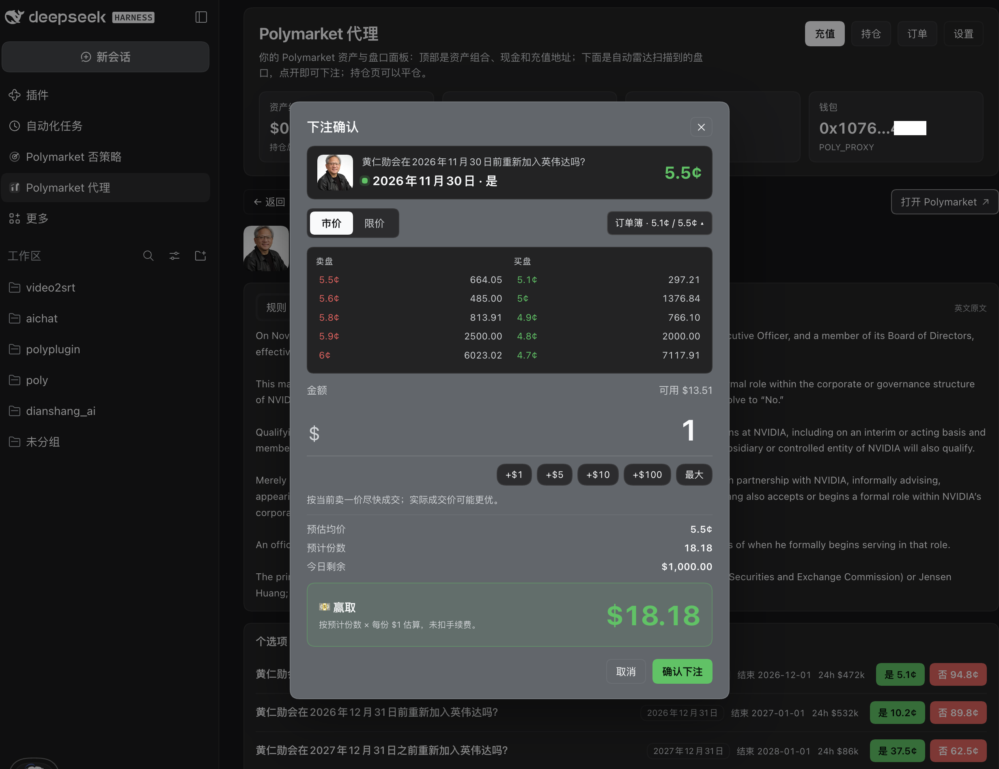

<div align="center">

# Polymarket Proxy

**A local Polymarket desk inside DeepSeek Harness — check your portfolio, deposit and trade, even when the official website won't let you.**

[English](README.md) · [简体中文](README.zh-CN.md)


</div>

---

## Why Polymarket Proxy?

Polymarket's own website is not available everywhere. The deposit page may refuse to
load, the trading UI may fail to connect a wallet, or the whole site may be blocked on
your network — while your account, your positions and Polymarket's liquidity are still
there.

Polymarket Proxy is a **local panel for DeepSeek Harness** that talks to the same public
Polymarket services directly:

- it reconstructs your **deposit address** from the public Polygon deposit history, so you
  can fund an account without the website's deposit modal;
- it signs order requests with **your own private key** through Polymarket's official CLOB
  client, so you can buy and sell without the website's trading screen;
- it keeps a **live market radar** of Polymarket's highest-volume events, so you can find
  and open a market without the website's front page.

> **Eligibility is still Polymarket's decision.** This project does not create accounts,
> bypass KYC, or change where you are. Use it only with an account you are allowed to use,
> and follow Polymarket's terms and your local laws. See [Disclaimer](#disclaimer).

## Screenshots

| Market radar | Event detail |
|---|---|
| [](assets/Snipaste1.png) | [](assets/Snipaste2.png) |
| Auto-refreshing events, ten categories, 24h volume, top outcomes — click any row to open it. | Original English rules, background tab, every outcome with live Yes/No prices. |

| Order confirmation |
|---|
| [](assets/Snipaste3.png) |
| Market or limit order, live order book, estimated average price, shares and potential payout. |

The screenshots show the Chinese interface; the English interface is identical apart from
the language. The panel follows the DeepSeek Harness language automatically — see
[Language](#language).

## Before you start

1. **You need a Polymarket account.** Register one here:
   [https://polymarket.com/perps?via=dEz1eSn](https://polymarket.com/perps?via=dEz1eSn)
2. **Install and configure DeepSeek Harness first.** Official site:
   [https://www.deepseek.com/harness/](https://www.deepseek.com/harness/)
3. **Install this plugin.** In the DeepSeek Harness **Plugins** page, click **Add plugin**
   and enter the npm package name **`dsh-polymarket-proxy`**. Alternatively, send this
   GitHub repository URL to a DeepSeek chat and let the AI install it.

## Features

- **Portfolio** — total value, cash, positions value and your proxy wallet address, read
  from Polymarket's public data APIs.
- **Deposit** — Polymarket deposit address recovered from public deposit history, with
  QR code and copy button; a manual paste fallback for brand-new accounts.
- **Market radar** — Gamma API sweep every 30 minutes by default (configurable), grouped
  by event and ranked by 24h volume; ten category chips, search, and a pasted
  `polymarket.com` event/market link opens markets the sweep leaves out.
- **Event detail** — rules and resolution source kept in the original English, a
  background tab, and every outcome with live Yes/No prices and 24h volume.
- **Betting** — market buy by USD amount or limit (GTC) buy by price and shares; the
  confirmation modal shows the order book, estimated average price, estimated shares,
  today's remaining budget and the potential payout.
- **Positions** — current and redeemable positions, history, and one-click market close.
- **Orders** — open orders listed in the panel, cancellable in place.
- **Agent tools** — two read-only tools let the agent list the radar
  (`polymarket_markets`) and summarize the portfolio (`polymarket_portfolio`).
- **Keyword filter** — a plain-text blocklist hides matching events from the radar and
  from the agent tool.
- **Language** — Chinese when DeepSeek Harness is Chinese, English for every other
  language; market titles are fetched in the same language.

## How it works

```
DeepSeek Harness Web UI
└── Polymarket Proxy panel (browser half: client.js)
    │  /api/polymarket-agent/*   (local HTTP, JSON)
    └── Polymarket Proxy Host plugin (index.js)
        ├── Gamma API        markets, events, tags, titles
        ├── Data API v2      portfolio, positions, activity feed
        ├── Polygon RPC      deposit history for address recovery
        ├── CLOB API         order book, cash balance, order placement
        └── @polymarket/client + viem   signing and submission
```

- **No backend service.** The Host half is a normal DSH plugin; it serves the panel from
  the same `dsh web` process on `127.0.0.1` and caches the radar in memory.
- **No Cookie or website session.** Only Polymarket's public APIs are used, plus the
  credentials you configure.
- **No `.env`.** Account material is written only to the DSH credentials store
  (`$DSH_HOME/.credentials.yaml`, mode `0600`); non-secret plugin state lives in
  `$DSH_HOME/polymarket-agent/state.json`.

## Requirements

- A [DeepSeek Harness](https://www.npmjs.com/package/@deepseek-ai/dsh) Web profile
  (`dsh web`).
- Node.js 24 or newer (the version DSH itself runs on).
- A Polymarket account with a proxy wallet (Proxy, Safe or Deposit type) and some USDC on
  Polygon. Trading needs Polymarket's gasless approvals once.
- A Relayer API key only if your account has never been approved for trading.

## Install

Three ways, from easiest to most manual. All of them end with **Polymarket Proxy** in the
left sidebar; reload the page once if it does not appear.

1. **npm package (recommended)** — open *Plugins* in the sidebar, choose *Add plugin*, enter
   `dsh-polymarket-proxy`, and confirm. Or simply ask the agent: *install the
   `dsh-polymarket-proxy` plugin*.
2. **GitHub repository** — send this repository's URL to a DeepSeek chat and ask it to
   install the plugin. The package is at the repository root, so the AI can install it
   directly.
3. **Local checkout** — for development, clone the repository and install its directory as
   a local bundle:

   ```bash
   git clone https://github.com/dennisyang1986/polymarket-proxy.git polymarket-proxy
   ```

   *Plugins* → *Install* → absolute path to the checkout
   (for example `/home/me/polymarket-proxy`).

Open the panel afterwards; a short setup guide runs the first time — see below.

## Setup

The first time you open the panel, a four-step guide collects what signing and reading
your account needs. Nothing is sent anywhere except Polymarket's own services; secrets go
straight into the DSH credentials store.

1. **Signing key** — copy the private key from polymarket.com (avatar → *Settings* →
   *Account* → sensitive section → *Export private key*). It signs orders locally and is
   stored only in the DSH credentials store.
2. **Account wallet** — the wallet tied to your Polymarket account (Proxy / Safe /
   Deposit). Copy it from your Polymarket profile; do **not** use your browser wallet
   address.
3. **Relayer** — only needed for the first gasless approval. Create an API key under
   *Settings* → *API keys* and paste both the API key and the signer address shown above
   it.
4. **Approve and caps** — run the one-time approvals, then set the per-order and daily
   USD caps and enable ordering in the panel. Defaults are deliberately small; raise them
   when you trust the setup.

You can reopen the guide from *Settings* at any time, and *Settings → Logout* clears the
local credentials and local order records (it never touches positions, open orders or
history on Polymarket).

## Usage

| Area | What you can do |
|---|---|
| Portfolio strip | Total value, cash, positions value, proxy wallet — refreshed automatically. |
| Radar | Filter by category or search; press *Refresh* to rescan; paste a Polymarket event/market link to open it directly. |
| Event detail | Read rules and resolution source, check outcomes, then *Buy Yes/No*. |
| Order modal | Choose *Market* (spend USD) or *Limit* (GTC, price and shares); review the order book, estimated price, shares, remaining daily budget and potential payout; confirm. |
| Positions | Current and redeemable positions, history; close a position at market in one click. |
| Orders | See in-progress and filled orders, cancel an open limit order. |
| Settings | Refresh interval (radar header); credentials, approvals, per-order and daily caps (guided); logout. |

**One click, no deal?** Orders are submitted to Polymarket's CLOB through the official
client; fills happen against live liquidity. The modal's estimate is not a guarantee.

### Deposit when the website's deposit page is unavailable

Open *Deposit*. For an account that has deposited before, the address is recovered from
the public Polygon deposit history of your account wallet — send USDC/USDT on Polygon to
that address and it arrives in the same account. A brand-new account has no history to
recover from: open the official deposit modal once (if you can), copy the address, and
paste it into the panel; it is remembered in the DSH credentials store.

## Agent tools

| Tool | What it returns |
|---|---|
| `polymarket_markets` | Radar events ranked by 24h volume, filtered by `query` / `category`, or one pasted Polymarket link; read-only. |
| `polymarket_portfolio` | Portfolio total, cash, deposit address source, open positions and trading status; read-only. |

Ordering and closing always stay with the human in the panel.

## Language

Polymarket Proxy does not add its own language switch. It follows DeepSeek Harness:

- Harness UI is **Chinese** → the panel and Polymarket market titles/questions are Chinese.
- Harness UI is **any other language** → everything is **English**, and market titles are
  fetched from Polymarket's English locale.

Change the language in DeepSeek Harness settings; the panel re-syncs and reloads the radar
in the matching language. Rules, resolution sources and other long descriptions always
come from Polymarket in the original English.

## Keyword filter

Events matching any word in `keywords.txt` (repository root, or
`$DSH_HOME/polymarket-agent/keywords.txt` for a packaged install) are hidden from the
radar and from the agent tool. It is edited as a plain text file, not in the panel. One
keyword per line; `#` starts a comment; commas and semicolons also separate words. The
file is read on every scan — save it and press *Refresh*. Links you paste are never
filtered. `keywords.default.txt` seeds a new file.

## Privacy and security

- **Local only.** The Host plugin serves under the same `dsh web` origin, and every route
  passes DSH's connection admission (Host/Origin checks plus the browser credential) before
  it runs. Credential and logout endpoints additionally accept loopback requests only.
- **Secrets in one place.** The wallet, private key and Relayer key live in the DSH
  credentials store (`$DSH_HOME/.credentials.yaml`, mode `0600`) — never in `.env`, logs,
  `state.json` or workspace snapshots. That store is plaintext YAML: rely on your OS account
  permissions and disk encryption, and prefer a dedicated or hardware wallet for large
  balances.
- **Orders are capped.** Per-order and daily USD caps, plus an explicit enable switch, are
  enforced by the Host before anything is signed. A cap change applies immediately.
- **Read-only tools.** Agent tools cannot place or cancel orders; that stays in the panel.
- **Public data only.** Market data and portfolio reads use Polymarket's public endpoints;
  no website cookies or scraped sessions.

## Troubleshooting

| Symptom | Fix |
|---|---|
| `Trading bridge not ready` | Complete the signing key and account wallet steps, then run *Approve everything* in *Settings*. |
| `Approvals missing` | Polymarket's one-time approvals were not submitted. Fill in the Relayer key/signer address and approve again. |
| Deposit address not identified | The account has no public deposit history yet. Paste the address from the official deposit modal once. |
| The radar is empty | Clear the search and category, then press *Refresh*; if it stays empty, lower `minVolume24h` or raise `maxDays` in the plugin settings and reload. |
| Titles do not match the interface language | Switch the Harness language once, or reload the page after changing it. The Host re-sweeps automatically. |
| Panel stopped working after an update | Reinstall the bundle from the `plugin` directory and reload the page. |

## Project layout

```
polymarket-proxy/
├── README.md              English README (this file)
├── README.zh-CN.md        Chinese README
├── LICENSE                MIT
├── package.json           npm package and DeepSeek Harness bundle manifest
├── cordis.patch.yml       Loader row inserted into the profile
├── index.js               Host half: APIs, radar, trading bridge, agent tools
├── bridge.js              @polymarket/client + viem signing/submission
├── client.js              Browser half: panel, views, i18n
├── locale/                plugin display title/description (en, zh)
├── keywords.txt           active keyword filter for this checkout
├── keywords.default.txt   seed for a new keyword file
├── screenshots.json       market screenshots declaration
└── assets/                icons and screenshots
```

## Disclaimer

Polymarket Proxy is an unofficial, local tool. It is **not affiliated with, endorsed by
or operated by Polymarket**. Polymarket's services and terms are owned by Polymarket; your
use of them is between you and Polymarket. Prediction markets involve risk of total loss,
and trading may be restricted or illegal in your jurisdiction. This software is provided
"as is", without warranty of any kind; you are solely responsible for the keys you load,
the orders you place and the laws that apply to you.

## License

MIT © 2026 Polymarket Proxy contributors. See [LICENSE](LICENSE).
