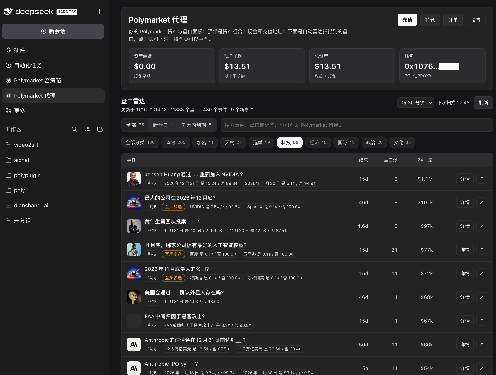
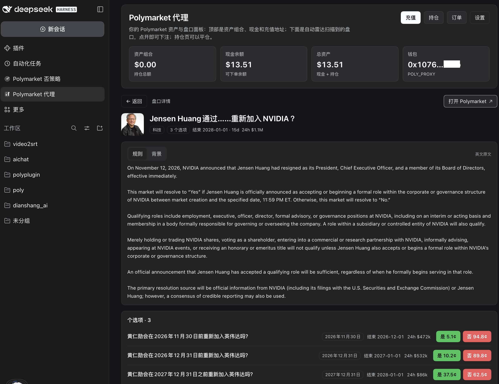
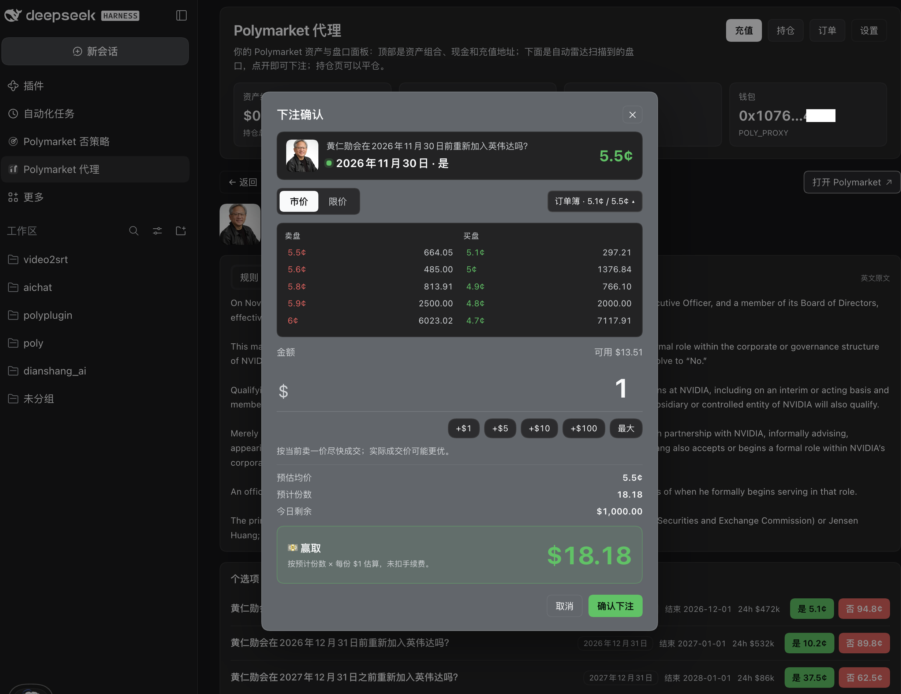

<div align="center">

# Polymarket Proxy

**装在 DeepSeek Harness 里的 Polymarket 本机面板：官网打不开时，也能看持仓、充值、交易。**

[English](README.md) · [简体中文](README.zh-CN.md)


</div>

---

## 为什么需要 Polymarket Proxy？

Polymarket 官网并不是在所有地方都能正常使用：充值页可能打不开，交易界面可能连不上
钱包，整个站点也可能在你的网络里不可访问——但你的账户、持仓和 Polymarket 的流动性
一直都在。

Polymarket Proxy 是一个 **DeepSeek Harness 的本机面板**，直接对接 Polymarket 的公开
服务：

- 从 Polygon 公开充值记录里**还原充值地址**，官网充值弹窗不可用时也能入金；
- 用**你自己的私钥**、通过 Polymarket 官方 CLOB 客户端签名下单，官网交易界面不可用时
  也能买卖；
- 维护一个**自动刷新的盘口雷达**，按 24 小时成交量聚合官网热门事件，官网首页不可用时
  也能找到并打开盘口。

> **账户资格仍由 Polymarket 判定。** 本项目不创建账户、不绕过 KYC，也不改变你所在的
> 地区。请只使用你有权使用的账户，并遵守 Polymarket 的条款和当地法律。详见
> [免责声明](#免责声明)。

## 界面截图

| 盘口雷达 | 盘口详情 |
|---|---|
| [](assets/Snipaste1.png) | [](assets/Snipaste2.png) |
| 自动刷新事件、十个分类、24 小时成交量、主要选项——点任意一行打开详情。 | 保留英文原文的规则与结算来源、背景标签页、每个选项的实时 Yes/No 价格。 |

| 下注确认 |
|---|
| [](assets/Snipaste3.png) |
| 市价或限价、实时订单簿、预估均价、预估份数与「赢取」金额。 |

截图是中文界面；英文界面除语言外完全一致。面板会自动跟随 DeepSeek Harness 的语言，
见[界面语言](#界面语言)。

## 使用前准备

1. **你需要有一个 Polymarket 账户。** 注册账号：
   [https://polymarket.com/perps?via=dEz1eSn](https://polymarket.com/perps?via=dEz1eSn)
2. **需要先安装并配置好 DeepSeek Harness。** 官网：
   [https://www.deepseek.com/harness/](https://www.deepseek.com/harness/)
3. **安装本插件。** 在 DeepSeek Harness 的**「插件」**页面点击**「添加插件」**，输入本
   软件的 npm 包名称 **`dsh-polymarket-proxy`**；或者把本 GitHub 仓库地址发给 DeepSeek
   聊天框，让 AI 帮你安装即可。

## 功能

- **资产组合**——总资产、现金、持仓市值和你的代理钱包地址，数据来自 Polymarket 公开
  接口。
- **充值**——从公开充值记录还原 Polymarket 充值地址，带二维码和复制按钮；全新账户可
  手动粘贴官网地址。
- **盘口雷达**——默认每 30 分钟抓取一次 Gamma API（可配置），按事件聚合、按 24 小时
  成交量排序；十类标签叠加筛选、搜索框，粘贴 `polymarket.com` 事件/盘口链接可直接
  打开雷达之外的市场。
- **盘口详情**——规则和结算来源保留英文原文，提供背景标签页，每个选项显示实时 Yes/No
  价格和 24 小时成交量。
- **下注**——市价按美元金额买入，或限价（GTC）按价格和份数挂单；确认弹窗展示订单簿、
  预估均价、预估份数、今日剩余额度和「赢取」金额。
- **授权**——首次下单前的一次性免 gas 授权。面板按「检查凭据 → 建立会话 → 读取链上授权
  → 提交并复核」四步显示每一步的通过、耗时和失败原因（例如
  `fetch failed (ENOTFOUND clob.polymarket.com)`）；「刷新状态」会强制重新检测，并自动
  重试一次瞬时网络失败。
- **持仓**——当前持仓、可赎回持仓、历史记录，一键市价平仓。
- **订单**——面板内列出进行中的订单，可直接撤单。
- **Agent 工具**——两个只读工具：让 Agent 列出雷达（`polymarket_markets`）、汇总资产
  （`polymarket_portfolio`）。
- **关键词过滤**——纯文本词表，命中任意词的事件不会出现在雷达和 Agent 列表里。
- **界面语言**——Harness 是中文时用中文，其它语言一律英文；盘口标题也按同一语言获取。

## 工作原理

```
DeepSeek Harness Web UI
└── Polymarket Proxy 面板（浏览器端：client.js）
    │  /api/polymarket-agent/*   （本机 HTTP，JSON）
    └── Polymarket Proxy Host 插件（index.js）
        ├── Gamma API        市场、事件、标签、标题
        ├── Data API v2      资产、持仓、活动记录
        ├── Polygon RPC      充值记录，用于还原充值地址
        ├── CLOB API         订单簿、现金余额、下单
        └── @polymarket/client + viem   签名与提交
```

- **没有额外后端。** Host 端就是一个普通 DSH 插件，由同一个 `dsh web` 进程在
  `127.0.0.1` 上提供面板接口，雷达缓存在内存里。
- **不需要 Cookie / 网站会话。** 只调用 Polymarket 公开接口，加上你配置的凭据。
- **不写 `.env`。** 账户材料只写入 DSH 凭据库（`$DSH_HOME/.credentials.yaml`，权限
  `0600`）；非敏感状态存放在 `$DSH_HOME/polymarket-agent/state.json`。

## 环境要求

- 一个 [DeepSeek Harness](https://www.npmjs.com/package/@deepseek-ai/dsh) Web 配置
  （`dsh web`）。
- Node.js 24 或以上（DSH 自身运行的版本）。
- 一个带代理钱包（Proxy / Safe / Deposit）的 Polymarket 账户，以及 Polygon 上的
  USDC。交易需要先完成 Polymarket 的免 gas 授权。
- 只有从未授权过的新账户才需要 Relayer API key。

## 安装

从简到繁有三种方式，安装后左侧栏都会出现 **Polymarket Proxy**；如果没有出现，刷新一次
页面。

1. **npm 包（推荐）**——左侧栏打开「插件」，点「添加插件」，输入
   `dsh-polymarket-proxy` 并确认；也可以直接对 Agent 说「安装 dsh-polymarket-proxy
   插件」。
2. **GitHub 仓库**——把本仓库地址发给 DeepSeek 聊天框，让 AI 帮你安装。插件包就在
   仓库根目录，AI 可以直接安装。
3. **本地源码**——用于开发调试：克隆仓库后，从本地目录安装：

   ```bash
   git clone https://github.com/dennisyang1986/polymarket-proxy.git polymarket-proxy
   ```

   「插件」→「安装」→ 填仓库根目录的绝对路径
   （例如 `/home/me/polymarket-proxy`）。

安装后打开面板；首次进入会显示四步引导，见下节。

## 首次配置

第一次打开面板时，引导会收集签名和读取账户所需的信息。除 Polymarket 自己的服务外，
这些信息不会发往任何地方；密钥直接写入 DSH 凭据库。

1. **签名私钥**——在 polymarket.com 头像 → 设置 → 账号 → 敏感中导出私钥并复制。它只在
   本机为订单签名，只保存在 DSH 凭据库。
2. **账户钱包**——与你 Polymarket 账户绑定的钱包（Proxy / Safe / Deposit）。从
   Polymarket 个人资料复制，**不要**填浏览器钱包地址。
3. **Relayer**——只有首次免 gas 授权需要。在设置 → API 密钥创建，把 API key 和上方显示
   的签名者地址一起填入。
4. **授权与限额**——完成一次性授权，然后设置单笔/每日美元限额。默认额度故意设得
   较小，确认无误后再调高。

之后可在「设置」里重新打开引导；「设置 → 注销」会清除本机凭据和本地订单记录，但不会
动 Polymarket 上的持仓、挂单和历史。

## 使用

| 区域 | 可以做什么 |
|---|---|
| 资产条 | 总资产、现金、持仓市值、代理钱包，自动刷新。 |
| 雷达 | 按分类筛选或搜索；点「刷新」重新扫描；粘贴 Polymarket 事件/盘口链接直接打开。 |
| 盘口详情 | 看规则和结算来源、各选项，然后「买入 Yes/No」。 |
| 下注弹窗 | 选「市价」（按美元金额）或「限价」（GTC，价格与份数）；查看订单簿、预估均价、份数、今日剩余额度与「赢取」金额后确认。 |
| 持仓 | 当前与可赎回持仓、历史记录；一键按市价平仓。 |
| 订单 | 查看进行中/已成交订单，撤销未成交的限价单。 |
| 设置 | 刷新间隔（雷达右上角）；凭据、授权、单笔/每日限额（引导式）；注销。 |

**点了就一定成交吗？** 订单通过官方客户端提交到 Polymarket CLOB，按实时流动性撮合；
弹窗里的估算是参考值，不是成交保证。

### 官网充值页不可用时如何充值

打开「充值」。如果账户以前充值过，插件会从账户钱包的 Polygon 公开充值记录里还原充值
地址——往该地址发送 Polygon 上的 USDC/USDT 即可到账到同一账户。全新账户没有记录：
如果还能打开官网充值弹窗，复制其中地址粘贴到面板一次即可，之后会记住在 DSH 凭据库里。

## Agent 工具

| 工具 | 返回内容 |
|---|---|
| `polymarket_markets` | 按 24h 成交量排序的雷达事件，可用 `query` / `category` 过滤，或传入一个 Polymarket 链接；只读。 |
| `polymarket_portfolio` | 资产总额、现金、充值地址来源、当前持仓和交易状态；只读。 |

下单和平仓始终由人在面板里操作。

## 界面语言

Polymarket Proxy 不单独提供语言开关，而是跟随 DeepSeek Harness：

- Harness 界面是**中文** → 面板与 Polymarket 盘口标题、问题都是中文。
- Harness 界面是**其它语言** → 界面全部英文，盘口标题也按 Polymarket 英文语言获取。

在 DeepSeek Harness 设置里切换语言后，面板会重新同步并按对应语言重新扫描雷达。规则、
结算来源等长文本始终保留 Polymarket 的英文原文。

## 关键词过滤

命中 `keywords.txt`（仓库根目录；打包安装时为
`$DSH_HOME/polymarket-agent/keywords.txt`）中任意词的事件，不会出现在雷达和 Agent
工具里。该文件用文本编辑器修改，不在面板里编辑。一行一个词，`#` 后为注释，逗号/分号
也能分隔多个词。每次扫描都会重新读取文件，保存后点「刷新」生效。手动粘贴的链接不受
过滤影响。`keywords.default.txt` 用于初始化新文件。

## 隐私与安全

- **只在本机。** Host 插件挂在同一个 `dsh web` 源上，所有路由都会先经过 DSH 的连接
  准入检查（Host/Origin 与浏览器凭据）；凭据与注销接口另外只接受回环请求。
- **密钥只存一处。** 钱包、私钥、Relayer key 只写入 DSH 凭据库
  （`$DSH_HOME/.credentials.yaml`，权限 `0600`），不会进 `.env`、日志、`state.json`
  或工作区快照。该文件是本机明文 YAML：安全性取决于操作系统账户权限与磁盘加密，大额
  资金建议使用独立钱包或硬件钱包。
- **下单有限额。** 单笔/每日美元限额由 Host 在签名前强制检查，修改即时生效。
- **Agent 工具只读。** Agent 工具不能下单或撤单，交易操作留在面板里。
- **只用公开数据。** 行情和资产读取走 Polymarket 公开接口，不需要网站 Cookie 或
  抓取会话。

## 常见问题

| 现象 | 处理 |
|---|---|
| 提示「交易桥未就绪」 | 完成签名私钥和账户钱包步骤，然后在「设置」里点「全部授权」。 |
| 提示「缺少授权」 | 一次性授权没有提交成功。填写 Relayer key 和签名者地址后重新授权。 |
| 提示 `fetch failed (…)` | 本机到 Polymarket 或 Relayer 的网络问题，括号里是实际错误码和域名。确认能访问 `clob.polymarket.com`、`polygon-bor-rpc.publicnode.com`、`relayer-v2.polymarket.com` 后点「刷新状态」。 |
| 识别不到充值地址 | 账户还没有公开充值记录。先用官网充值弹窗复制地址，粘贴到面板一次。 |
| 雷达为空 | 清空搜索和分类后点「刷新」；仍然为空时，在插件设置里调低 `minVolume24h` 或调高 `maxDays` 后重载。 |
| 标题语言和界面对不上 | 在 Harness 里切换一次语言，或切换后刷新页面；Host 会自动重新扫描。 |
| 更新后面板不工作 | 从 `plugin` 目录重新安装插件包，并刷新页面。 |

## 目录结构

```
polymarket-proxy/
├── README.md              英文说明（本文件）
├── README.zh-CN.md        中文说明
├── LICENSE                MIT
├── package.json           npm 包与 DeepSeek Harness 插件清单
├── cordis.patch.yml       插入到配置里的 Loader 行
├── index.js               Host：接口、雷达、交易桥、Agent 工具
├── bridge.js              @polymarket/client + viem 签名与提交
├── client.js              浏览器端：面板、视图、多语言
├── locale/                插件显示名称/描述（en、zh）
├── keywords.txt           当前检出的关键词过滤表
├── keywords.default.txt   新关键词文件的种子
├── screenshots.json       市场截图声明
└── assets/                图标与截图
```

## 免责声明

Polymarket Proxy 是非官方的本机工具，**与 Polymarket 没有隶属、背书或运营关系**。
Polymarket 的服务与条款归 Polymarket 所有，你对它们的使用属于你和 Polymarket 之间的
关系。预测市场存在全部损失的风险，且交易在某些司法辖区可能受限或违法。本软件按
「原样」提供，不附带任何担保；你载入的密钥、下的订单以及适用的法律，均由你自己负责。

## 许可证

MIT © 2026 Polymarket Proxy contributors，详见 [LICENSE](LICENSE)。
